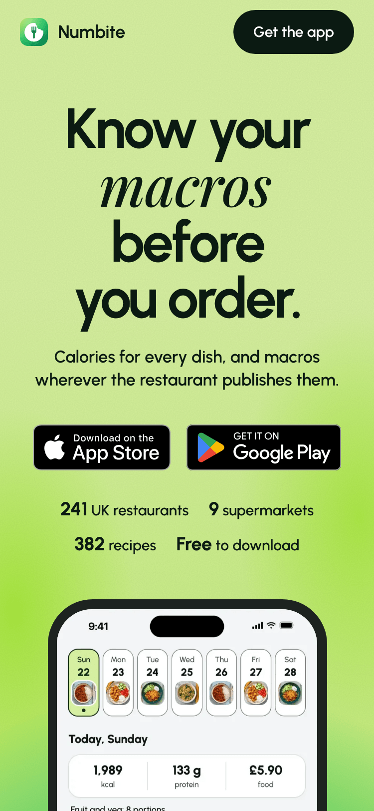
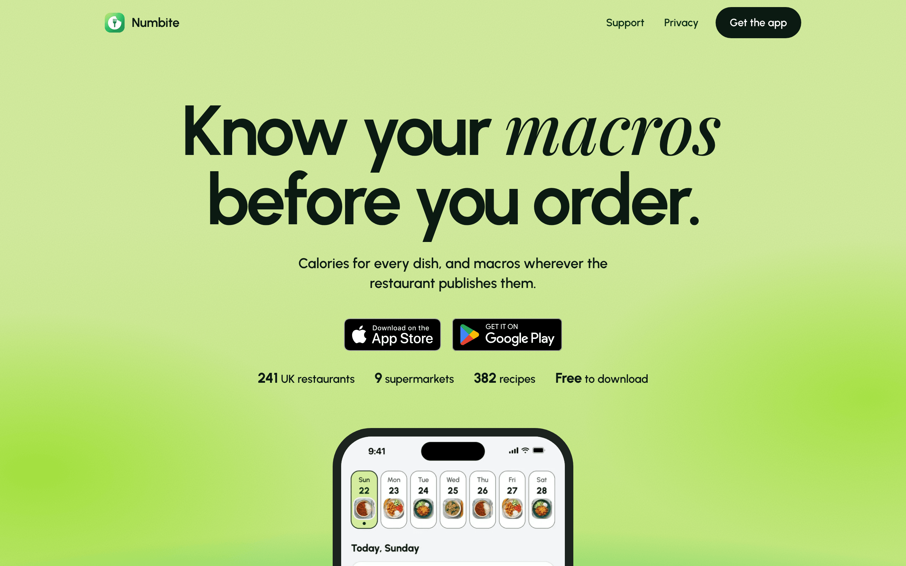
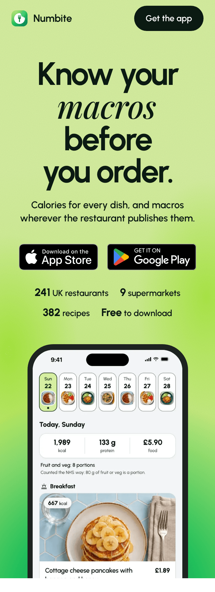

# numbite.com homepage hero: direction "A. Lime" (27 November 2026)

Branch `claude/site-hero-lime`, **rebased onto `claude/site-no-web-app`** at 88294cf8, the other session's branch that closes the web app (it sits on
`main` at da6f5d80). All of that branch's changes are kept: `/app` redirects to the homepage's badges on Vercel builds, there are no links to the web app,
and the header pill says "Get the app". So merging this branch brings both in. **Not live:** nothing was merged into `main` or deployed to production. The
founder decides when.

The model was Opal's site (opalapp.com): one huge headline, one short line, the store button, and Safari's Smart App Banner. Numbite's version uses its own
brand lime and its own app screens.

## Screenshots

Taken at 2x from `next start` on this branch. The first two show the first screen; the third shows the whole hero on a phone, down to the green
behind the phone:

| 375 px (iPhone) | 1280 px (desktop) | The whole hero at 375 px |
|---|---|---|
|  |  |  |

## Vercel preview

The branch preview is **https://menumacros-git-claude-site-hero-lime-aman-moneysave.vercel.app**, the same branch-address pattern as
`claude/site-download-buttons`. Like every preview it sits behind the Vercel login. Vercel starts building it when the branch is pushed.

## What changed

**The hero** (`web/app/(site)/page.tsx`, styles in `web/app/globals.css` under "The homepage hero")
- **Lime, edge to edge, with a sunrise.** The founder found the flat lime "slightly boring" and asked for "some kind of gradient ... whatever you
  think" (27 November), so the hero is now a gradient in the colours of **the app's own icon** (`web/design/icon.svg`: lime #a3e635, green #22c55e,
  deep green #047857, now the tokens `--icon-lime`, `--icon-green` and `--icon-deep`). No colour outside the brand was added.
  - The top is exactly the brand lime `--sun` (#d6efa0).
  - The icon's bright lime comes in from both sides lower down.
  - The icon's green rises like a horizon behind the phone.
  - A very fine grain (a tiny inline noise tile, nothing to download) keeps the large gradients from banding.

  This is the only gradient on the site: an exception, for this hero only, to the flat look decided on 2026-10-15. The words never sit on the green;
  it starts below the proof row. With the iPhone's "Increase contrast" setting on, the hero goes back to flat lime. Four variants were tried; this one
  was chosen because it joins the header with no seam and keeps every word on lime.

  The hero fills the first screen under the header (`min-height: 100svh` minus the header). On the homepage the header turns the same lime, with the
  same grain, so the header and hero read as one block. Its quieter links (Support, Privacy) switch to `--on-sun`.
- **Headline.** The existing words, "Know your *macros* before you order.", with "macros" still in the Playfair serif italic. It is now all black, as the
  direction asked (it was green before). Size: 56 px on a 375 px phone and up to 100 px on desktop, with tight leading. Four lines on a phone; two lines
  from 1024 px ("Know your macros / before you order.").
- **One short line.** `site.description` runs to four lines on a phone, so the hero uses a shorter line with the same claim, kept in
  `site.config.ts` as `heroLine`: **"Calories for every dish, and macros wherever the restaurant publishes them."** It fits on two lines at 375 px and at
  1280 px. **This is new copy: please approve it or give your own.** `site.description` itself is unchanged, and the page metadata still uses it.
- **The two official badges** are unchanged and now centred. They use the other branch's shared `StoreBadges` with its `get-the-app` anchor, so
  "Get the app" in the header and every old `/app` address land on them.
- **Proof row, true counts only.** The figures are read when the site is built, and nothing is typed by hand:
  - **UK restaurants**: from the menus manifest, sample chains left out. 241 today.
  - **supermarkets**: from `groceries/all/all-manifest.json`, keeping only the shops `app-content.json` packs into the apps. 9 today, the same count the
    app's own welcome screen shows.
  - **recipes**: every recipe in the book (`RECIPES`). 382 today.
  - **Free to download.**

  There are no ratings or awards. A count whose data is missing is left out (`heroProof` in `lib/mm/catalogue.ts`, with tests), and a missing data file
  stops the build rather than letting it show a wrong figure. Note that the 9 supermarkets include Lidl, whose list has prices but few labels (39 of
  1,037 products have nutrition). The app counts it the same way.
- **Phone rising from the bottom edge.** An ink frame drawn in CSS (no new image) holding the real app screens, cut off by the hero's bottom edge. It
  crossfades slowly through **four** screens, each shown for 5 seconds with a 1.2 second fade:
  - **Meal plan**: the week's dishes and today's calories, protein and cost, with our own recipe pictures (the pancakes). It comes first.
  - **Home**: the day's calories, protein, carbs and fat.
  - **Best for you**: lunches ranked by protein for their calories, each with the dish's own photo.
  - **Nutrition leaderboards** from Groceries.

  **Where the pictures come from (changed the same evening):** the founder asked for "the images of the screens from the App Store", because the copies
  retaken in the cloud had no food photos. So `web/e2e/site-screens.mjs` now fetches the ten screenshots from the live App Store listing (Apple's
  1320 × 2868 originals) for the "See it on your phone" row, exactly as the store shows them, photos and logos included. `web/e2e/hero-screens.mjs` cuts the
  phone's screens from those, keeping only the top 70% of each, the part the hero shows. None of the four has a logo in that part. The founder's decision is
  recorded in CLAUDE.md rule 2. The files are in `web/public/screens/hero/` (14 to 61 KB each).
- **Reduced motion.** With Reduce Motion on, the phone stands still on Meal plan. The other three screens are hidden and never downloaded.
- **No Pause button.** This follows the founder's decision for the welcome screen's logo wall on 20 November ("There's literally no point of a pause
  button"): Reduce Motion is the way to stop it. Strictly, WCAG 2.2.2 asks for a pause control on motion that lasts more than 5 seconds. Say if you want
  one: it is a small change.
- **Taken out of the hero:**
  - the "Know before you order" kicker, which repeated the headline;
  - the "Open the web app" button (already gone on `claude/site-no-web-app`);
  - the sentence about the free account;
  - the three proof cards (restaurant count, items with calories or macros, "Every number"). The Eat out card and the "Numbers you can trust" section
    still say where the figures come from.

  Everything below the hero is as on `claude/site-no-web-app`.

**Smart App Banner, on the website only**
- `<meta name="apple-itunes-app" content="app-id=6822767746">` is on every page of the website: the homepage, privacy, terms, support, the chain pages and
  so on. It comes from `app/(site)/layout.tsx` through `lib/smartAppBanner.ts`, and the ID is `site.appStoreId`.
- It is left out when `APP_BUILD` is set, so the copy packed into the iPhone and Android apps (`scripts/build_app_web.sh`, `scripts/build_android_web.sh`)
  never offers the app inside itself. Tested in `tests/smartAppBanner.test.ts`, and checked in real builds: the website build has exactly one tag per page,
  and the apps' static export (`APP_BUILD=1 next build`) has none in any file.
- `scripts/pack_app_web.py` now also leaves `screens/` out of the phone apps. Only the website's homepage shows those pictures, and the pack replaces the
  homepage with a redirect, so they were about 1.3 MB of dead weight in each app.

## Checks (all on this branch, after the rebase)

- `npm test`: **passed**. 189 test files, 4,246 tests (22 skipped, as before), including the new `tests/heroColours.test.ts` (the sunrise's colours
  come from the icon, black words stay above 11:1 on every lime the words can sit on, and the top is exactly `--sun`). One test from the other branch was loosened:
  `tests/secondPassOffline.test.ts` pinned the exact line `ALWAYS_OUT = {"menus-sample", "sw.js"}`. It now checks that the set holds `"sw.js"` and
  `"screens"`.
- `npm run lint`: **passed**. 0 errors; 4 warnings, all in older e2e scripts this change doesn't touch.
- `npm run typecheck`: **passed**.
- `npm run build`: **passed**. The apps' static export (`APP_BUILD=1 next build`) also built, and the pack script ran on it.
- **375 px and 1280 px** against `next start`:
  - **Layout:** headline 56.4 px (4 lines) and 100 px (2 lines); the short line in 2 lines at both widths; the badges side by side; the proof row in
    two rows of two on the phone and one row on desktop; no sideways scroll.
  - **Accessibility:** axe (WCAG 2.0/2.1/2.2 A and AA, plus best practice) found **no violations** at either width. The keyboard reaches the header, both
    badges and the screenshots row, and the focus ring is the site's green.
- **Speed:** with the CPU slowed 4×, the browser's Largest Contentful Paint is the **headline** at both widths, at 130 to 180 ms. The first screen picture
  is 13 to 29 KB and the next two load after it at low priority. Nothing in the hero animates in.
- **Contrast on the lime, all above AA:**

  | What | Ratio |
  |---|---|
  | Words (`--foreground`) on flat lime | 14.28:1 |
  | Words on the sunrise, measured on the real pixels behind them (grain included) | 11:1 or more; 9.9:1 at 200% text |
  | Header links (`--on-sun`) | 11.86:1 |
  | Focus ring (`--accent`) | 5.12:1 |
  | Phone frame (`--ink`) | 12.72:1 |

  The phone screens have alt text describing each one.

## How to undo it

- **Before it goes live:** don't merge `claude/site-hero-lime`. Nothing on `main` or numbite.com has changed. To ship the closed web app without the new
  hero, merge `claude/site-no-web-app` alone.
- **After a merge:** `git revert` the hero commit ("numbite.com homepage: the Lime hero …") on `main` and push. This brings back the old hero (with the
  closed web app kept), takes out the Smart App Banner and puts `screens/` back in the app packs.
- **Fastest after it is live:** Vercel › Project menumacros › Deployments › the previous production deployment › Instant Rollback.
- **Only the banner:** in `app/(site)/layout.tsx`, change `smartAppBanner(APP_BUILD, site.appStoreId)` to `{}`.
- **Only the gradient:** in `web/app/globals.css`, set `.hero-lime`'s `background` to `var(--sun)` and the lime header's to `var(--sun)`. That brings
  back the flat lime.
- **Only the motion:** delete the `@media (prefers-reduced-motion: no-preference)` block under "The homepage hero" in `web/app/globals.css`. The phone
  then shows Home only.

## For the founder to decide

1. The short line under the headline (above).
2. Whether the header should stay lime down the whole homepage, as built, or go back to white once you scroll past the hero.
3. A Pause button on the phone (no, as built, following the logo wall).
4. The sunrise gradient (as built) or the flat lime (one line to switch back, above).
